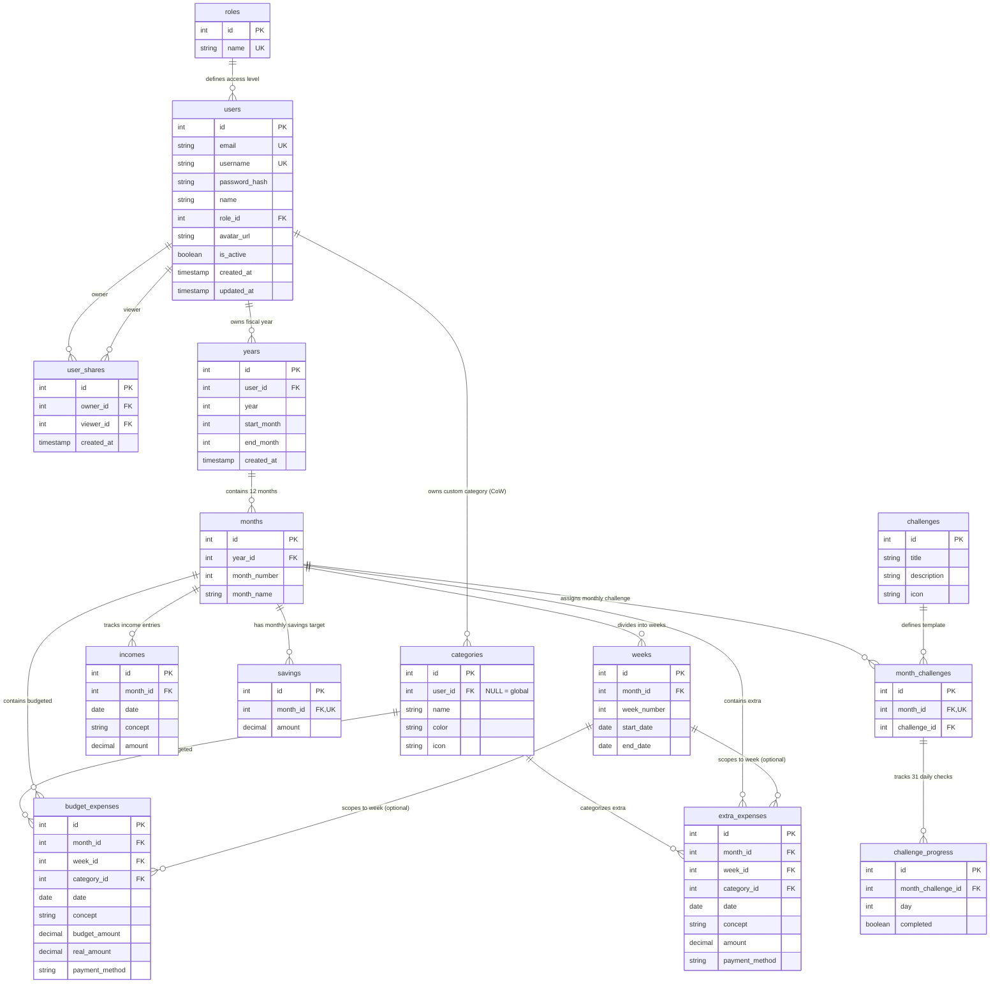
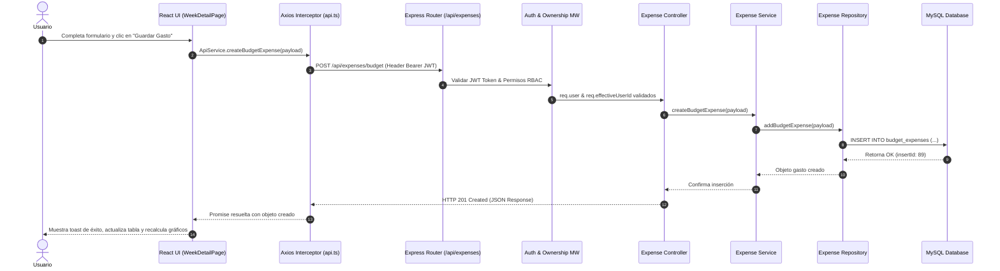

# 🐼 熊猫理财 El Panda Ahorrador — Documentación Técnica del Sistema
**Versión de Arquitectura**: 2.0 (Grado Senior / Enterprise Ready)  
**Última Actualización**: Agosto 2026  

Documentación técnica y arquitectónica completa del sistema de gestión presupuestaria y finanzas personales **Panda Ahorrador (熊猫理财)**. Este documento proporciona una visión exhaustiva de 360 grados sobre el modelo de datos relacional en MySQL, las migraciones incrementales, la arquitectura limpia del backend en Node.js/Express, el flujo de seguridad JWT y control de acceso multi-inquilino (RBAC / Multi-tenancy), la presentación reactiva en el frontend con **React 18 + TypeScript + Vite**, y la infraestructura de contenedorización con **Docker** y **Nginx**.

---

## 📋 Tabla de Contenidos
1. [Visión General del Sistema y Ficha Técnica](#1-visión-general-del-sistema-y-ficha-técnica)
2. [Arquitectura de Base de Datos (MySQL)](#2-arquitectura-de-base-de-datos-mysql)
   - [Diagrama Entidad-Relación Completo](#diagrama-entidad-relación-completo)
   - [Diccionario de Tablas (13 Tablas)](#diccionario-de-tablas-13-tablas)
   - [Estrategia de Migraciones y Scripts SQL](#estrategia-de-migraciones-y-scripts-sql)
3. [Arquitectura del Backend (Node.js & Express)](#3-arquitectura-del-backend-nodejs--express)
   - [Estructura de Capas (Clean Architecture)](#estructura-de-capas-clean-architecture)
   - [Seguridad, JWT Lifecycle (Access + Refresh Token) y Bcrypt](#seguridad-jwt-lifecycle-access--refresh-token-y-bcrypt)
   - [RBAC y Middleware de Propiedad de Datos (`resolveOwnership`)](#rbac-y-middleware-de-propiedad-de-datos-resolveownership)
   - [Patrones de Negocio: Copy-on-Write y Shortcuts](#patrones-de-negocio-copy-on-write-y-shortcuts)
   - [Catálogo Exhaustivo de Endpoints REST API (30+ Endpoints)](#catálogo-exhaustivo-de-endpoints-rest-api-30-endpoints)
   - [Manejo de Errores y Logging Multinivel](#manejo-de-errores-y-logging-multinivel)
4. [Arquitectura del Frontend (React 18 + TypeScript + Vite)](#4-arquitectura-del-frontend-react-18--typescript--vite)
   - [Estructura de Carpetas Modular](#estructura-de-carpetas-modular)
   - [Enrutamiento y Guardias de Navegación (`ProtectedRoute`)](#enrutamiento-y-guardias-de-navegación-protectedroute)
   - [Gestión de Estado Global (Context API: Auth & Toast)](#gestión-de-estado-global-context-api-auth--toast)
   - [Cliente HTTP Axios (Interceptores de Token & Auto-Refresh)](#cliente-http-axios-interceptores-de-token--auto-refresh)
   - [Vistas Principales y Dashboard Interactivo (Chart.js)](#vistas-principales-y-dashboard-interactivo-chartjs)
   - [Sistema de Diseño SCSS Glassmorphism Panda](#sistema-de-diseño-scss-glassmorphism-panda)
5. [Flujo de Datos Extremo a Extremo (E2E)](#5-flujo-de-datos-extremo-a-extremo-e2e)
   - [Traza de Ejecución Paso a Paso](#traza-de-ejecución-paso-a-paso)
   - [Diagrama de Secuencia E2E (Mermaid)](#diagrama-de-secuencia-e2e-mermaid)
6. [Despliegue, Contenedorización & Guía Operativa (DevOps)](#6-despliegue-contenedorización--guía-operativa-devops)
   - [Configuración de Docker (Backend & Multi-Stage Frontend)](#configuración-de-docker-backend--multi-stage-frontend)
   - [Configuración de Servidor Nginx SPA (`nginx.conf`)](#configuración-de-servidor-nginx-spa-nginxconf)
   - [Matriz de Variables de Entorno](#matriz-de-variables-de-entorno)
   - [Comandos de CLI y Scripts NPM](#comandos-de-cli-y-scripts-npm)

---

## 1. Visión General del Sistema y Ficha Técnica

**Panda Ahorrador (熊猫理财)** es una plataforma web enterprise-grade para la planificación financiera personal y familiar. El sistema permite gestionar presupuestos anuales, desglose mensual de ingresos y ahorros, seguimiento semanal de gastos presupuestados frente a reales, trazabilidad por medios de pago, categorías personalizables, retos dinámicos de ahorro y acceso compartido multi-usuario con restricciones de solo lectura.

### Ficha Técnica del Stack Tecnológico:

```
+-----------------------------------------------------------------------------------+
|                                  STACK TECNOLÓGICO                                |
+-----------------------+-----------------------------------------------------------+
| Base de Datos         | MySQL 8.0+ (CleverCloud / Docker / Local MySQL)           |
|                       | Connection Pool (mysql2/promises), Transacciones SQL      |
+-----------------------+-----------------------------------------------------------+
| Backend Runtime       | Node.js v20 LTS, Express v4.21.2                          |
| Autenticación/AuthZ   | JWT (jsonwebtoken 9.0), Bcryptjs (3.0), Dynamic RBAC      |
| Archivos & Utilities  | Multer 2.2 (Uploads), Winston 3.17 (Logger), CORS 2.8     |
+-----------------------+-----------------------------------------------------------+
| Frontend Runtime      | React 18.3.1 + TypeScript 5.5.4 + Vite 5.4.1             |
| Router & State        | React Router DOM v6.26, React Context API                 |
| HTTP & Charts         | Axios 1.7 (Interceptors), Chart.js 4.4 / react-chartjs-2  |
| UI & Icons            | Vanilla SCSS (Glassmorphism Panda Theme), FontAwesome 6.6 |
+-----------------------+-----------------------------------------------------------+
| DevOps & Deploy       | Docker Engine, Dockerfiles Multi-stage, Nginx Alpine      |
+-----------------------+-----------------------------------------------------------+
```

---

## 2. Arquitectura de Base de Datos (MySQL)

El motor de base de datos relacional utiliza MySQL con un esquema estricto de integridad referencial, índices compuestos para acelerar la resolución de contextos multi-inquilino y restricciones de unicidad que garantizan consistencia de datos a nivel de motor.

### Diagrama Entidad-Relación Completo



---

### Diccionario de Tablas (13 Tablas)

#### 1. `roles`
Catálogo de niveles de acceso del sistema (RBAC).
- `id` (`INT`, PK, AUTO_INCREMENT): Identificador del rol.
- `name` (`VARCHAR(20)`, UNIQUE, NOT NULL): Nombre clave del rol (`admin`, `regular`, `viewer`).

#### 2. `users`
Almacena las credenciales y el estado de los usuarios registrados.
- `id` (`INT`, PK, AUTO_INCREMENT): ID único del usuario.
- `email` (`VARCHAR(255)`, UNIQUE, NOT NULL): Correo electrónico.
- `username` (`VARCHAR(50)`, UNIQUE, NOT NULL): Nombre de usuario para autenticación.
- `password_hash` (`VARCHAR(255)`, NOT NULL): Contraseña encriptada con Bcrypt.
- `name` (`VARCHAR(100)`, NOT NULL): Nombre de muestra del usuario.
- `role_id` (`INT`, FK -> `roles.id`, DEFAULT 2): Rol asignado (2 = `regular`).
- `avatar_url` (`VARCHAR(500)`, NULL): Ruta relativa de la foto de perfil en el servidor.
- `is_active` (`BOOLEAN`, DEFAULT TRUE): Bandera de estado activo/desactivado.
- `created_at` / `updated_at` (`TIMESTAMP`): Marcas de tiempo de auditoría.

#### 3. `user_shares`
Tabla pivot para acceso multi-inquilino de lectura compartida (Regular $\rightarrow$ Viewer).
- `id` (`INT`, PK, AUTO_INCREMENT): ID de la relación.
- `owner_id` (`INT`, FK -> `users.id` ON DELETE CASCADE): Usuario propietario de la información.
- `viewer_id` (`INT`, FK -> `users.id` ON DELETE CASCADE): Usuario espectador con permiso de lectura.
- `created_at` (`TIMESTAMP`): Fecha de otorgamiento del permiso.
- **Clave Única Compuesta**: `uq_share (owner_id, viewer_id)`.

#### 4. `years`
Presupuestos anuales asociados a un usuario específico.
- `id` (`INT`, PK, AUTO_INCREMENT): ID del registro anual.
- `user_id` (`INT`, FK -> `users.id` ON DELETE CASCADE): Propietario del año fiscal.
- `year` (`INT`, NOT NULL): Número de año (ej. 2026).
- `start_month` (`INT`, DEFAULT 1): Mes de inicio (1-12).
- `end_month` (`INT`, DEFAULT 12): Mes de fin (1-12).
- `created_at` (`TIMESTAMP`): Fecha de creación.
- **Clave Única Compuesta**: `uq_user_year (user_id, year)`.

#### 5. `months`
Meses pertenecientes a cada año fiscal.
- `id` (`INT`, PK, AUTO_INCREMENT): ID único del mes.
- `year_id` (`INT`, FK -> `years.id` ON DELETE CASCADE): Referencia al año fiscal.
- `month_number` (`INT`, NOT NULL): Número de mes (1 a 12).
- `month_name` (`VARCHAR(20)`, NOT NULL): Nombre en español (Enero, Febrero, etc.).
- **Clave Única Compuesta**: `uq_year_month (year_id, month_number)`.

#### 6. `incomes`
Registro de ingresos mensuales.
- `id` (`INT`, PK, AUTO_INCREMENT): ID del ingreso.
- `month_id` (`INT`, FK -> `months.id` ON DELETE CASCADE): Referencia al mes.
- `date` (`DATE`, NOT NULL): Fecha de recepción.
- `concept` (`VARCHAR(255)`, NOT NULL): Descripción (ej. "Nómina", "Freelance").
- `amount` (`DECIMAL(12,2)`, DEFAULT 0.00): Valor del ingreso.

#### 7. `savings`
Meta o saldo asignado a ahorro mensual.
- `id` (`INT`, PK, AUTO_INCREMENT): ID del registro.
- `month_id` (`INT`, FK -> `months.id` ON DELETE CASCADE, UNIQUE): Referencia única por mes.
- `amount` (`DECIMAL(12,2)`, DEFAULT 0.00): Monto asignado.

#### 8. `weeks`
División semanal dentro de cada mes.
- `id` (`INT`, PK, AUTO_INCREMENT): ID de la semana.
- `month_id` (`INT`, FK -> `months.id` ON DELETE CASCADE): Referencia al mes.
- `week_number` (`INT`, NOT NULL): Número de semana en el mes (1 a 5).
- `start_date` / `end_date` (`DATE`): Fechas límite de la semana.
- **Clave Única Compuesta**: `uq_month_week (month_id, week_number)`.

#### 9. `categories`
Categorías globales del sistema y personalizadas por usuario.
- `id` (`INT`, PK, AUTO_INCREMENT): ID de la categoría.
- `user_id` (`INT`, FK -> `users.id`, DEFAULT NULL): `NULL` indica categoría global del sistema; un `user_id` indica categoría creada por un usuario (Copy-on-Write).
- `name` (`VARCHAR(50)`, NOT NULL): Nombre de la categoría.
- `color` (`VARCHAR(10)`, NOT NULL): Código Hexadecimal de color UI.
- `icon` (`VARCHAR(30)`): Emoji o icono representativo.
- **Clave Única Compuesta**: `uq_cat_name_user (name, user_id)`.

#### 10. `budget_expenses`
Gastos presupuestados (Planificado vs Real) con trazabilidad de medio de pago.
- `id` (`INT`, PK, AUTO_INCREMENT): ID del gasto presupuestado.
- `month_id` (`INT`, FK -> `months.id` ON DELETE CASCADE): Mes contenedor.
- `week_id` (`INT`, FK -> `weeks.id` ON DELETE SET NULL): Semana opcional.
- `category_id` (`INT`, FK -> `categories.id`): Categoría asociada.
- `date` (`DATE`, NOT NULL): Fecha de ejecución.
- `concept` (`VARCHAR(255)`, NOT NULL): Concepto del gasto.
- `budget_amount` (`DECIMAL(12,2)`, DEFAULT 0.00): Presupuestado.
- `real_amount` (`DECIMAL(12,2)`, DEFAULT 0.00): Ejecutado real.
- `payment_method` (`VARCHAR(100)`, DEFAULT ''): Medio de pago (ej. "Efectivo", "Tarjeta Débito", "Nequi").

#### 11. `extra_expenses`
Gastos imprevistos fuera del presupuesto.
- `id` (`INT`, PK, AUTO_INCREMENT): ID del gasto extra.
- `month_id` (`INT`, FK -> `months.id` ON DELETE CASCADE): Mes contenedor.
- `week_id` (`INT`, FK -> `weeks.id` ON DELETE SET NULL): Semana opcional.
- `category_id` (`INT`, FK -> `categories.id`): Categoría asociada.
- `date` (`DATE`, NOT NULL): Fecha del gasto.
- `concept` (`VARCHAR(255)`, NOT NULL): Concepto del gasto.
- `amount` (`DECIMAL(12,2)`, DEFAULT 0.00): Monto ejecutado.
- `payment_method` (`VARCHAR(100)`, DEFAULT ''): Medio de pago utilizado.

#### 12. `challenges`
Catálogo global de 15 retos de ahorro financiero pre-cargados.
- `id` (`INT`, PK, AUTO_INCREMENT): ID del reto.
- `title` (`VARCHAR(100)`, NOT NULL): Título del reto (ej. 🐜 No gastos hormiga).
- `description` (`TEXT`, NOT NULL): Explicación y reglas.
- `icon` (`VARCHAR(50)`): Emoji representativo.

#### 13. `month_challenges` y `challenge_progress`
Asignación mensual de retos y seguimiento diario (31 días).
- `month_challenges`: Asocia `month_id` (UNIQUE) con `challenge_id`.
- `challenge_progress`: Registra para cada `month_challenge_id` el estado `completed` (`BOOLEAN`) del día `1` al `31`.
- **Clave Única Compuesta**: `uq_challenge_day (month_challenge_id, day)`.

---

### Estrategia de Migraciones y Scripts SQL

El proyecto maneja las evoluciones de esquema mediante archivos SQL declarativos y scripts de Node.js en `/back/database` y `/back/src/scripts`:

```
back/
├── database/
│   ├── schema.sql                     # Schema base + Seeds (Categorías iniciales + 15 Retos)
│   ├── auth-migration.sql             # Tabla roles, users, user_shares + Columna user_id en years
│   ├── user-categories-migration.sql  # Soporte de categorías personalizadas (user_id + uq_cat_name_user)
│   ├── add-payment-method.sql         # Columna payment_method en budget_expenses y extra_expenses
│   └── fix-years-unique.sql           # Clave única compuesta (user_id, year) en years
└── src/scripts/
    ├── init-db.js                     # Ejecuta schema.sql
    ├── run-auth-migration.js          # Ejecuta auth-migration.sql e inicializa usuario admin
    └── run-new-migrations.js          # Ejecuta migrations incrementales en secuencia
```

---

## 3. Arquitectura del Backend (Node.js & Express)

El backend implementa **Clean Architecture** (Arquitectura Limpia en Capas), separando de forma estricta las capas de transporte HTTP, orquestación de negocio y persistencia de datos.

```
back/src/
├── config/           # Configuración central (database.js, environment.js, logger.js)
├── routes/           # Mapeo de rutas HTTP, middlewares de Auth y RBAC
├── middlewares/      # auth.middleware, role.middleware, ownership.middleware, error-handler
├── controllers/      # Extracción de parámetros HTTP y emisión de respuestas JSON
├── services/         # Lógica de negocio pura (Copy-on-Write, cálculos, validaciones)
├── repositories/     # Consultas SQL directas sobre mysql2 Connection Pool
├── utils/            # Helpers de fechas y utilidades
└── app.js            # Bootstrap del servidor Express
```

---

### Seguridad, JWT Lifecycle (Access + Refresh Token) y Bcrypt

1. **Hashing de Contraseñas**:
   - `bcryptjs` con costo de salado (`saltRounds = 10`). Nunca se almacenan ni retornan contraseñas en texto plano.
2. **Ciclo de Vida del Token JWT**:
   - **Access Token**: Token de vida corta firmado con `JWT_SECRET` enviado en el header `Authorization: Bearer <token>`. Contiene en su payload: `{ id, username, email, role_id, role_name }`.
   - **Refresh Token**: Permite la renovación transparente del token expirable invocando `POST /api/auth/refresh` sin forzar la re-autenticación del usuario.

---

### RBAC y Middleware de Propiedad de Datos (`resolveOwnership`)

El sistema implementa una arquitectura multi-inquilino de aislamiento de datos respaldada por el middleware `ownership.middleware.js`:

```javascript
// snippet conceptual de ownership.middleware.js
const resolveOwnership = async (req, res, next) => {
  const { role, id: userId } = req.user;

  if (role === 'admin') {
    // Admin puede impersonar o consultar cualquier usuario vía query param ?viewAs=userId
    req.effectiveUserId = req.query.viewAs ? parseInt(req.query.viewAs) : userId;
    return next();
  }

  if (role === 'viewer') {
    // Viewer consulta datos compartidos por un owner si existe registro en user_shares
    const viewAs = req.query.viewAs ? parseInt(req.query.viewAs) : null;
    const hasAccess = await authRepository.shareExists(viewAs, userId);
    if (!hasAccess) return res.status(403).json({ message: 'Sin acceso a los datos' });

    req.effectiveUserId = viewAs;
    req.isViewer = true;
    return next();
  }

  // Regular: Aislamiento estricto de sus propios datos
  req.effectiveUserId = userId;
  next();
};
```

Los endpoints mutativos (`POST`, `PUT`, `DELETE`) están protegidos adicionalmente por `authorize('admin', 'regular')`, garantizando que los usuarios con rol `viewer` tengan acceso estrictamente de **solo lectura**.

---

### Patrones de Negocio: Categorías Directas y Shortcuts

- **Gestión Directa de Categorías & Estado `<Sin Categorizar>`**:  
  Las categorías se editan y eliminan de forma directa de acuerdo a las preferencias del usuario. Al eliminar una categoría, sus gastos asociados no se borran sino que se desvinculan (`category_id = NULL`), quedando clasificados automáticamente bajo la etiqueta **`<Sin Categorizar>`** en tono blanco (`#FFFFFF`) con icono `🏷️`.
- **Shortcuts ("Hoy")**:  
  El endpoint `GET /api/shortcuts/today` analiza la fecha del servidor, localiza el año fiscal actual del usuario, obtiene el mes en curso, la semana correspondiente al día de hoy y el reto mensual activo, ofreciendo un objeto consolidado de navegación rápida.

---

### Catálogo Exhaustivo de Endpoints REST API (30+ Endpoints)

| Módulo | Método | Ruta HTTP | Descripción | Permisos / Auth |
| :--- | :--- | :--- | :--- | :--- |
| **Auth** | `POST` | `/api/auth/register` | Registro de nuevos usuarios regular | Público |
| **Auth** | `POST` | `/api/auth/login` | Autenticación y entrega de Tokens JWT | Público |
| **Auth** | `POST` | `/api/auth/refresh` | Renovación de Access Token mediante Refresh Token | Público |
| **Profile**| `GET` | `/api/profile` | Obtener datos del perfil autenticado | Autenticado |
| **Profile**| `PUT` | `/api/profile` | Actualizar nombre y correo del usuario | Autenticado |
| **Profile**| `PUT` | `/api/profile/password` | Cambiar contraseña actual | Autenticado |
| **Profile**| `POST`| `/api/profile/avatar` | Subida de foto de perfil (Multer) | Autenticado |
| **Admin** | `GET` | `/api/admin/users` | Listar todos los usuarios registrados | Requiere `admin` |
| **Admin** | `PUT` | `/api/admin/users/:id/status` | Activar o desactivar estado del usuario | Requiere `admin` |
| **Admin** | `PUT` | `/api/admin/users/:id/role` | Cambiar rol del usuario (`admin`, `regular`, `viewer`)| Requiere `admin` |
| **Admin** | `DELETE`| `/api/admin/users/:id` | Eliminar usuario y sus datos en cascada | Requiere `admin` |
| **Share** | `GET` | `/api/share/users` | Buscar usuarios disponibles para compartir | `regular` / `admin` |
| **Share** | `POST` | `/api/share` | Compartir acceso de lectura con un espectador | `regular` / `admin` |
| **Share** | `GET` | `/api/share/active` | Obtener lista de comparticiones activas | `regular` / `viewer` |
| **Share** | `DELETE`| `/api/share/:id` | Revocar permiso de lectura a un Viewer | `regular` / `admin` |
| **Categories**|`GET`| `/api/categories` | Obtener categorías visibles | Autenticado |
| **Categories**|`POST`| `/api/categories` | Crear nueva categoría | Autenticado |
| **Categories**|`PUT`| `/api/categories/:id` | Editar categoría directamente | Autenticado |
| **Categories**|`DELETE`|`/api/categories/:id` | Eliminar categoría (gastos pasan a `<Sin Categorizar>`) | Autenticado |
| **Years** | `GET` | `/api/years` | Obtener años creados por el usuario activo | Autenticado / Ownership |
| **Years** | `POST` | `/api/years` | Crear año presupuestal y generar sus 12 meses | Autenticado / Ownership |
| **Years** | `GET` | `/api/years/:id` | Detalle del año presupuestal | Autenticado / Ownership |
| **Years** | `DELETE`| `/api/years/:id` | Eliminar año fiscal en cascada | Autenticado / Ownership |
| **Months**| `GET` | `/api/months/year/:yearId` | Listar los 12 meses de un año | Autenticado / Ownership |
| **Months**| `GET` | `/api/months/:id` | Obtener detalle completo del mes | Autenticado / Ownership |
| **Weeks** | `GET` | `/api/weeks/month/:monthId` | Obtener semanas asociadas al mes | Autenticado / Ownership |
| **Weeks** | `GET` | `/api/weeks/:id` | Detalle completo de la semana (gastos, totales por categoría y por medio de pago) | Autenticado / Ownership |
| **Incomes**| `GET` | `/api/incomes/month/:monthId` | Listar ingresos del mes | Autenticado / Ownership |
| **Incomes**| `POST` | `/api/incomes` | Registrar nuevo ingreso mensual | Autenticado / Ownership |
| **Incomes**| `PUT` | `/api/incomes/:id` | Actualizar registro de ingreso (fecha, concepto, monto) | Autenticado / Ownership |
| **Incomes**| `DELETE`| `/api/incomes/:id` | Eliminar registro de ingreso | Autenticado / Ownership |
| **Expenses**|`GET` | `/api/expenses/budget/month/:monthId`| Obtener gastos presupuestados del mes | Autenticado / Ownership |
| **Expenses**|`POST` | `/api/expenses/budget` | Crear gasto presupuestado (con `payment_method`)| `regular` / `admin` |
| **Expenses**|`PUT` | `/api/expenses/budget/:id` | Actualizar gasto presupuestado | `regular` / `admin` |
| **Expenses**|`DELETE`| `/api/expenses/budget/:id` | Eliminar gasto presupuestado | `regular` / `admin` |
| **Expenses**|`GET` | `/api/expenses/extra/month/:monthId` | Obtener gastos adicionales/imprevistos | Autenticado / Ownership |
| **Expenses**|`POST` | `/api/expenses/extra` | Registrar gasto imprevisto (con `payment_method`)| `regular` / `admin` |
| **Expenses**|`PUT` | `/api/expenses/extra/:id` | Actualizar gasto imprevisto | `regular` / `admin` |
| **Expenses**|`DELETE`| `/api/expenses/extra/:id` | Eliminar gasto imprevisto | `regular` / `admin` |
| **Challenges**|`GET`| `/api/challenges` | Catálogo de los 15 retos de ahorro | Autenticado |
| **Challenges**|`GET`| `/api/challenges/month/:monthId` | Obtener reto asignado al mes | Autenticado / Ownership |
| **Challenges**|`POST`| `/api/challenges/assign` | Asignar o cambiar reto del mes | `regular` / `admin` |
| **Challenges**|`POST`| `/api/challenges/toggle-day` | Marcar/Desmarcar cumplimiento de día (1-31) | `regular` / `admin` |
| **Summary**| `GET` | `/api/summary/month/:monthId` | Resumen mensual (Totales, Balance, Gráficos)| Autenticado / Ownership |
| **Summary**| `GET` | `/api/summary/year/:yearId` | Resumen anual consolidado | Autenticado / Ownership |
| **Shortcuts**|`GET`| `/api/shortcuts/today` | Accesos directos y estado del día actual | Autenticado / Ownership |
| **Health**  | `GET` | `/api/health` | Estado del servidor y backend | Público |

---

### Manejo de Errores y Logging Multinivel

- **Captura Global de Excepciones (`error-handler.middleware.js`)**: Intercepta cualquier excepción no controlada en la cadena de middlewares o servicios, emitiendo una respuesta estandarizada `{ success: false, message: ... }` y código HTTP acorde (`400`, `401`, `403`, `404`, `409`, `500`).
- **Winston Logger (`config/logger.js`)**: Almacena registros de auditoría en `/logs/app.log` con niveles (`info`, `warn`, `error`) y salida formateada por consola.

---

## 4. Arquitectura del Frontend (React 18 + TypeScript + Vite)

El frontend está construido sobre **React 18** utilizando **TypeScript**, empaquetado con **Vite** para máxima velocidad de desarrollo y compilación.

### Estructura de Carpetas Modular

```
front/src/
├── assets/           # Recursos estáticos (Imágenes, SVG, Favicons)
├── components/       # Componentes reutilizables y comunes (Navbar, ChineseDecoration, ProtectedRoute)
├── config/           # Configuración de entornos e instancias
├── context/          # Estados globales (AuthContext, ToastContext)
├── environments/     # Variables de entorno por ambiente
├── pages/            # Vistas principales organizadas por dominio
│   ├── admin/        # UserManagementPage (Panel de Administración RBAC)
│   ├── auth/         # LoginPage, RegisterPage
│   ├── landing/      # LandingPage (Presentación y Accesos Directos)
│   ├── months/       # MonthLayoutPage (Resumen mensual de semanas)
│   ├── settings/     # SettingsPage (Perfil, Contraseña y Avatar)
│   ├── share/        # ShareManagementPage (Gestión de espectadores)
│   ├── weeks/        # WeekDetailPage (Presupuestos, Medios de Pago y Retos)
│   └── years/        # YearListPage, YearDashboardPage
├── services/         # Capa de comunicación HTTP (api.ts, api.service.ts, auth.service.ts)
├── styles.scss       # Hoja de estilos global y tema Glassmorphism Panda
├── types/            # Interfaces e Inmunidades de TypeScript (`index.ts`)
├── App.tsx           # Configuración de Router y Providers
└── main.tsx          # Punto de entrada ReactDOM
```

---

### Enrutamiento y Guardias de Navegación (`ProtectedRoute`)

La navegación utiliza **React Router DOM v6**. Las rutas protegidas se envuelven en el componente `<ProtectedRoute>`:

```tsx
<Route
  path="/admin"
  element={
    <ProtectedRoute allowedRoles={['admin']}>
      <UserManagementPage />
    </ProtectedRoute>
  }
/>
```

- Si el usuario no está autenticado $\rightarrow$ Redirecciona a `/login`.
- Si el rol del usuario no coincide con `allowedRoles` $\rightarrow$ Redirecciona a la página principal `/`.

---

### Gestión de Estado Global (Context API: Auth & Toast)

1. **`AuthContext`**:
   - Mantiene el token de acceso JWT, datos del usuario autenticado (`user`), lista de propietarios disponibles si el usuario es `viewer` y el ID del propietario en observación (`viewAs`).
   - Sincroniza el almacenamiento en `localStorage` (`panda_access_token`, `panda_refresh_token`, `panda_user`).
2. **`ToastContext`**:
   - Expone métodos globales (`showSuccess`, `showError`, `showInfo`) para renderizar alertas flotantes interactivas en toda la aplicación.

---

### Cliente HTTP Axios (Interceptores de Token & Auto-Refresh)

El archivo `front/src/services/api.ts` implementa la gestión avanzada de peticiones mediante **Axios Interceptors**:

1. **Request Interceptor**: Inyecta el encabezado `Authorization: Bearer <token>` en cada llamada saliente.
2. **Response Interceptor (Auto-Refresh en HTTP 401)**:
   - Si una petición falla con `401 Unauthorized`, el interceptor pausa la petición saliente y ejecuta silenciosamente `POST /api/auth/refresh` enviando el `refreshToken`.
   - Al recibir los nuevos tokens, los actualiza en `localStorage`, actualiza el header de la petición fallida y la reintenta automáticamente.
   - Si la renovación falla o el `refreshToken` venció, limpia el storage y redirige al usuario a `/login`.

---

### Vistas Principales y Dashboard Interactivo (Chart.js)

- **Dashboard Anual (`YearDashboardPage`)**: Visualización analítica mediante `react-chartjs-2`. Presenta gráficos comparativos de Ingresos vs Gastos por mes y distribución porcentual por categorías.
- **Detalle de Semana (`WeekDetailPage`)**:
  - Tabla de **Gastos Presupuestados** (Categoría, Concepto, Presupuesto, Real, Diferencia, Medio de Pago).
  - Tabla de **Gastos Extraordinarios**.
  - **Checklist Interactivo del Reto del Mes**: Grilla de 31 días sincronizada con el backend para seguimiento diario de hábitos de ahorro.

---

### Sistema de Diseño SCSS Glassmorphism Panda

- **Estética Visual**: Tema oscuro profundo con fondos de gradiente radial, contenedores con efecto de vidrio esmerilado (`backdrop-filter: blur(12px)`), bordes brillantes con gradientes sutiles y acentos culturales asiáticos (`ChineseDecoration`).
- **Layout Responsivo**: Adaptativo a escritorios, tablets y dispositivos móviles.

---

## 5. Flujo de Datos Extremo a Extremo (E2E)

### Traza de Ejecución Paso a Paso

A continuación se detalla el recorrido completo de una acción del usuario (Ejemplo: **Creación de un Gasto Presupuestado con Medio de Pago**):

1. **Interacción UI (React Component)**: El usuario en `WeekDetailPage` completa el formulario e ingresa el monto, concepto, categoría y medio de pago ("Tarjeta Débito"). Presiona "Guardar Gasto".
2. **Llamada al Servicio (`ApiService`)**: Se invoca `ApiService.createBudgetExpense(expenseData)`.
3. **Axios Interceptor (`api.ts`)**: Inyecta el token Bearer en el encabezado `Authorization` y despacha la petición `POST /api/expenses/budget`.
4. **Recepción Express (`routes/expense.routes.js`)**: El router captura la petición y ejecuta la secuencia de middlewares.
5. **Evaluación de Auth & RBAC (`auth.middleware.js`, `role.middleware.js`)**: Valida que el token JWT sea auténtico y que el rol del usuario sea `admin` o `regular`.
6. **Resolución de Ownership (`ownership.middleware.js`)**: Setea `req.effectiveUserId` garantizando el aislamiento de datos.
7. **Controlador (`expense.controller.js`)**: Extrae el body de la petición y llama a `expense.service.js`.
8. **Servicio de Negocio (`expense.service.js`)**: Valida que los montos sean numéricos positivos y ejecuta la inserción.
9. **Persistencia MySQL (`expense.repository.js`)**: Ejecuta la consulta SQL parametrizada:
   ```sql
   INSERT INTO budget_expenses (month_id, week_id, category_id, date, concept, budget_amount, real_amount, payment_method)
   VALUES (?, ?, ?, ?, ?, ?, ?, ?);
   ```
10. **Respuesta HTTP 201**: El backend retorna `{ success: true, data: { id: 89, ... } }`.
11. **Actualización de Estado React**: El componente actualiza el estado local de React, provocando el re-renderizado instantáneo de las tablas de gastos y el recálculo dinámico de los gráficos en pantalla.

---

### Diagrama de Secuencia E2E (Mermaid)



---

## 6. Despliegue, Contenedorización & Guía Operativa (DevOps)

### Configuración de Docker (Backend & Multi-Stage Frontend)

#### Backend Dockerfile (`/back/Dockerfile`)
```dockerfile
FROM node:20-alpine
WORKDIR /app
COPY package*.json ./
RUN npm ci --only=production --legacy-peer-deps
COPY . .
RUN mkdir -p uploads
EXPOSE 3000
ENV NODE_ENV=production
CMD ["node", "src/app.js"]
```

#### Frontend Dockerfile Multi-Etapa (`/front/Dockerfile`)
```dockerfile
# Etapa 1: Build de la SPA con Vite
FROM node:20-alpine AS build
WORKDIR /app
COPY package*.json ./
RUN npm ci
COPY . .
RUN npm run build

# Etapa 2: Servidor Web Nginx de producción
FROM nginx:alpine
COPY --from=build /app/dist /usr/share/nginx/html
COPY nginx.conf /etc/nginx/conf.d/default.conf
EXPOSE 80
CMD ["nginx", "-g", "daemon off;"]
```

---

### Configuración de Servidor Nginx SPA (`nginx.conf`)

El archivo `/front/nginx.conf` proporciona soporte nativo para HTML5 Client-Side Routing en Single Page Applications (SPA), tipos MIME optimizados y reglas de almacenamiento en caché para activos estáticos:

```nginx
server {
    listen 80;
    server_name localhost;

    include /etc/nginx/mime.types;
    default_type application/octet-stream;

    # Fallback para HTML5 Single Page Application Routing
    location / {
        root /usr/share/nginx/html;
        index index.html index.htm;
        try_files $uri $uri/ /index.html;
    }

    # Optimización de caché para archivos estáticos (JS, CSS, Imágenes)
    location ~* \.(js|css|png|jpg|jpeg|gif|ico|svg|woff|woff2|ttf|eot)$ {
        root /usr/share/nginx/html;
        expires 30d;
        add_header Cache-Control "public, no-transform";
        log_not_found off;
    }

    error_page 500 502 503 504 /5x.x.html;
    location = /5x.x.html {
        root /usr/share/nginx/html;
    }
}
```

---

### Matriz de Variables de Entorno

#### Backend (`back/.env`)
```env
PORT=3000
NODE_ENV=development

# Conexión Base de Datos MySQL
DB_HOST=localhost
DB_PORT=3306
DB_USER=root
DB_PASSWORD=tu_password
DB_NAME=panda_ahorrador

# Secreto y expiración JWT
JWT_SECRET=super_secret_key_panda_ahorrador_2026
JWT_EXPIRES_IN=7d

# URL del Cliente para CORS
CLIENT_URL=http://localhost:4200
```

#### Frontend (`front/.env` y `front/.env.production`)
```env
VITE_API_URL=http://localhost:3000/api
```

---

### Comandos de CLI y Scripts NPM

#### Backend (`/back`):
- `npm run init-db`: Ejecuta la creación del esquema base e insersión de semillas (`schema.sql`).
- `npm run migrate-auth`: Ejecuta la migración del sistema de usuarios, roles y relaciones (`auth-migration.sql`).
- `npm run migrate-new`: Ejecuta las migraciones incrementales de categorías personalizadas, medios de pago y arreglos de índices.
- `npm run dev`: Inicia el servidor de desarrollo con `nodemon` en el puerto 3000.
- `npm start`: Inicia el servidor en modo producción con `node src/app.js`.

#### Frontend (`/front`):
- `npm run dev` / `npm start`: Inicia el servidor de desarrollo de Vite en `http://localhost:4200`.
- `npm run build`: Ejecuta la verificación de tipos con `tsc -b` y compila los activos optimizados de producción en la carpeta `dist/`.
- `npm run preview`: Previsualiza localmente el build compilado de producción.

---

*Documentación técnica de arquitectura mantenida para 🐼 熊猫理财 El Panda Ahorrador — 2026.*
